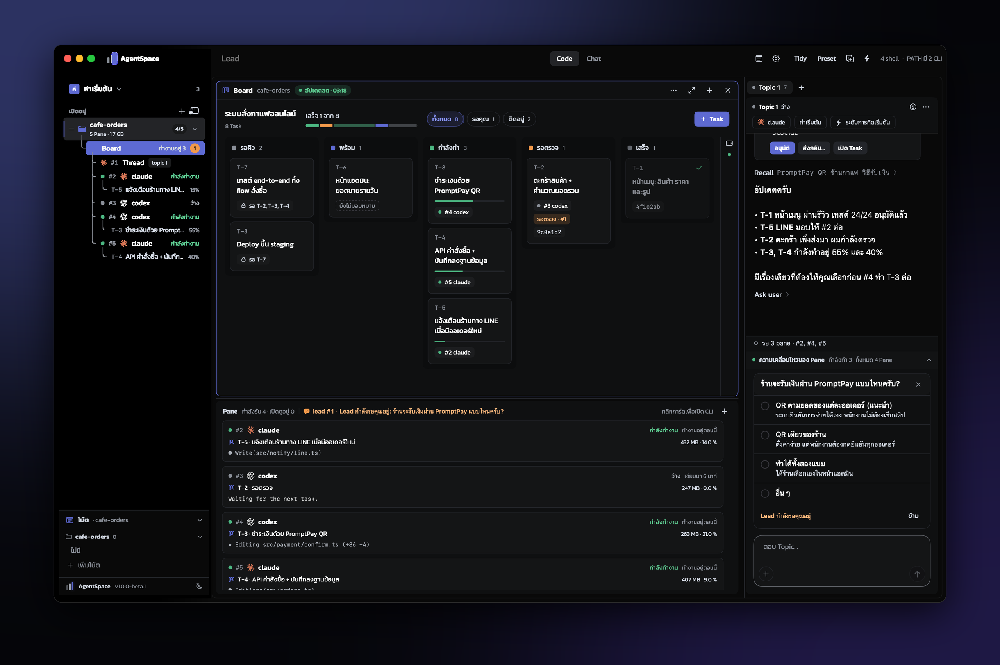
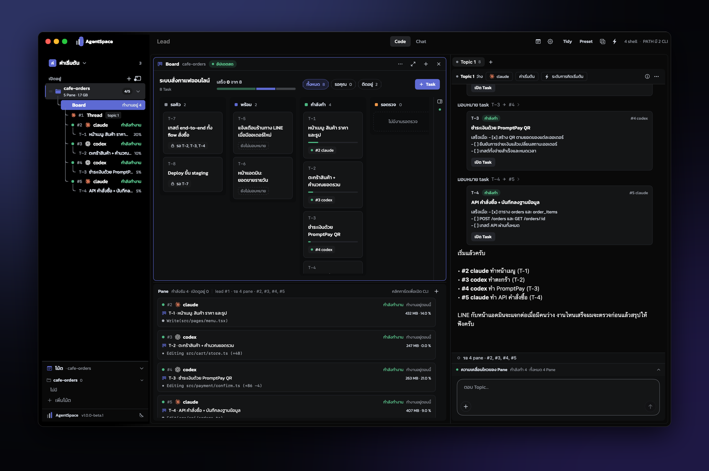
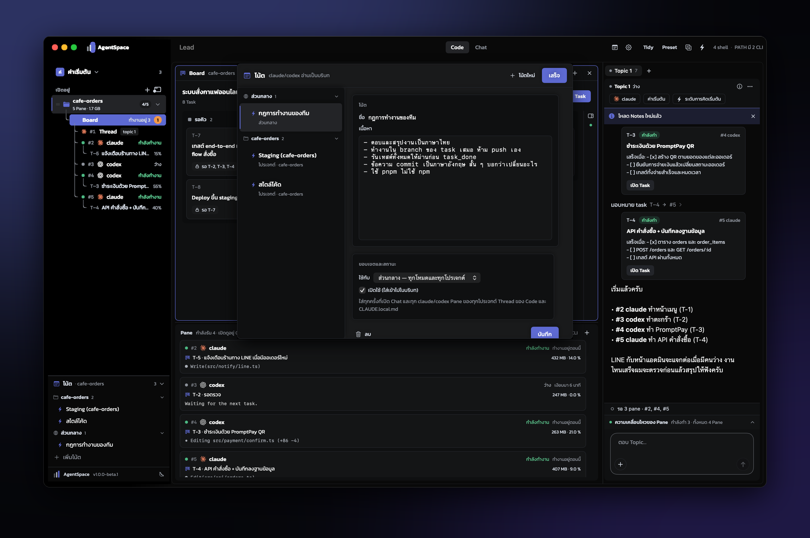
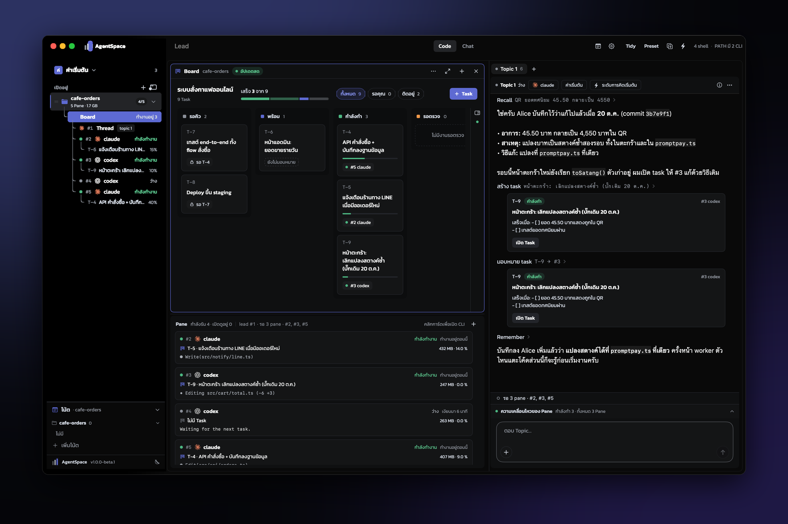
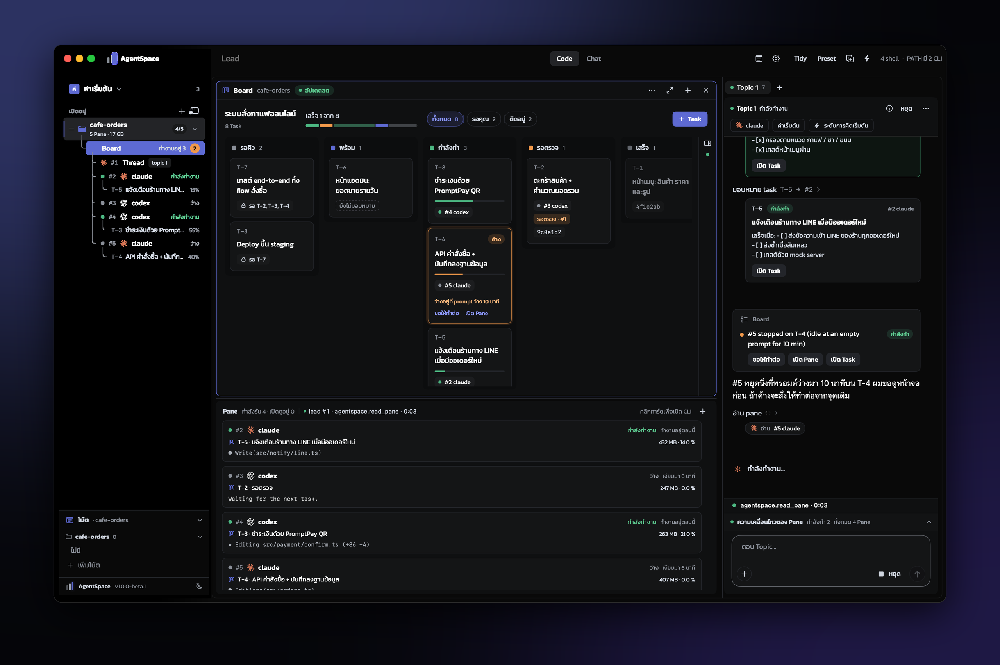
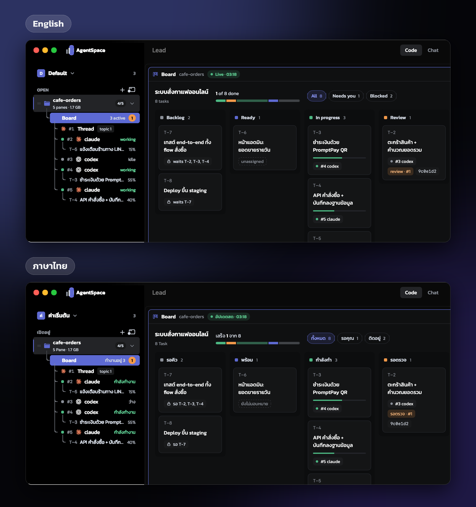

<h1 align="center">AgentSpace</h1>

<b>ทีม AI ที่ทำงานแทนคุณได้ตั้งแต่ต้นจนจบ</b>

คุยกับ lead คนเดียว แล้วให้ Claude Code และ Codex หลายตัวช่วยกันทำงานบน Mac ของคุณ 
lead แตกงาน แจกงาน ตรวจงาน และสรุปผลให้คุณ ทั้งหมดอยู่ในแอปเดียว ใช้ฟรี

  <a href="https://github.com/icueth/agentspace-releases/releases/latest"><b>⬇️ ดาวน์โหลด AgentSpace สำหรับ macOS (ฟรี)</b></a> 
  macOS 15 ขึ้นไป · Apple Silicon และ Intel · sign ด้วย Developer ID และผ่าน notarize ของ Apple

  

ทุกภาพในหน้านี้เป็นหน้าจอจริงของแอป ใช้โปรเจกต์ตัวอย่างและข้อมูลสมมุติ

## ทำงานยังไง

1. **บอกสิ่งที่อยากได้กับ lead** ในแชตข้างกระดานงาน พิมพ์ภาษาไทยได้เลย
2. **lead แตกงานเป็น task บนกระดาน** แต่ละ task บอกไว้ชัดว่าแบบไหนถึงเรียกว่าเสร็จ และต้องรองานไหนก่อน
3. **lead เปิด Claude Code หรือ Codex เป็น worker** ตัวละ pane แล้วแจกงานให้ งานที่ทำพร้อมกันได้จะแยก branch ของตัวเอง
4. **worker รายงานความคืบหน้า** ติ๊ก checklist แล้วส่งงานเข้าคอลัมน์รอตรวจ
5. **lead ตรวจงาน** แล้วอนุมัติหรือส่งกลับให้แก้ จากนั้นสรุปให้คุณฟัง
6. **เรื่องที่ต้องให้คุณตัดสิน** ขึ้นเป็นการ์ดคำถามเหนือช่องพิมพ์ คลิกคำตอบเดียวก็ส่งถึง lead ทันที

worker ทุกตัวคือ CLI ตัวจริงใน pane ของมันเอง คลิกการ์ดเพื่อดูหน้าจอหรือพิมพ์คุยกับมันตรง ๆ ได้ทุกเมื่อ

   
  สั่งครั้งเดียว: lead แตกเป็น 8 task เปิด worker 4 ตัว แล้วแจกงานให้เอง

## จุดเด่น

### 📝 Notes: เขียนครั้งเดียว ทุก agent รู้

กฎการทำงานของทีม ข้อตกลงในโปรเจกต์ ที่อยู่เซิร์ฟเวอร์ หรือรหัสที่ agent ต้องใช้ เขียนไว้ใน Notes ครั้งเดียว แล้ว AgentSpace จะส่งให้ทุก agent ที่เปิด ทั้ง lead และ worker ทั้ง Claude Code และ Codex

- เลือกได้ว่าโน้ตไหนใช้ทุกโปรเจกต์ และโน้ตไหนใช้เฉพาะโปรเจกต์เดียว
- แก้โน้ตระหว่างทำงานได้ lead จะโหลดใหม่ตอนว่างครั้งถัดไปแล้วบอกคุณ ส่วน worker ที่เปิดใหม่ได้ฉบับล่าสุดทันที
- โน้ตของโปรเจกต์ถูกเก็บในไฟล์ `CLAUDE.local.md` ที่ git ไม่ track และ agent ถูกสั่งให้อ่านค่าลับจากไฟล์นี้ตอนรัน ไม่คัดลอกลงโค้ดหรือ commit

  

### 🧠 Alice: ความจำระยะยาว ข้ามวัน ข้าม session

[Alice](https://github.com/icueth/alice) จำการตัดสินใจพร้อมเหตุผล บั๊กที่เคยแก้ (อาการ สาเหตุ วิธีแก้) และวิธีทำงานต่าง ๆ ไว้ให้ agent ค้นก่อนตอบ งานเมื่อวานหรือเมื่อเดือนก่อน agent ตัวใหม่ก็รู้ ไม่ต้องเล่าใหม่ทุกครั้ง

- มี Alice ในตัวแอปและเปิดให้อัตโนมัติ ความจำเก็บอยู่ในเครื่องของคุณ ถ้าคุณใช้ Alice อยู่แล้ว AgentSpace จะใช้ตัวเดิมของคุณ
- Claude Code และ Codex ใช้ความจำชุดเดียวกัน
- Alice เป็นโอเพนซอร์ส: <https://github.com/icueth/alice>

   
  บั๊กเดิมกลับมา: lead ค้นเจอใน Alice ว่าเคยแก้ยังไง เปิด task ให้แก้ด้วยวิธีเดิม แล้วจดบทเรียนเพิ่ม

### 🔁 ทำงานต่อเนื่อง ไม่หลุดกลางทาง

- **ปิดแอปหรือรีสตาร์ตเครื่อง pane ก็กลับมา** แต่ละตัวทำงานต่อจากบทสนทนาเดิมของมัน ด้วยเลข pane เดิม
- **Mac ไม่หลับระหว่างที่ agent ทำงาน** (ปิดได้ใน Settings)
- **กระดานจับ worker ที่หยุดนิ่ง** ไม่ว่าจะค้างที่พรอมต์ว่างหรือเจอ error การ์ดจะขึ้นป้าย lead ได้รับแจ้ง และมีปุ่ม "ขอให้ทำต่อ"
- worker ที่รอคำตอบนานเกิน 5 นาทีจะแจ้งเตือนคุณ

  

### 🇹🇭 ภาษาไทยหรืออังกฤษ

ทั้งแอปแสดงเป็นภาษาไทยหรืออังกฤษก็ได้ เลือกใน Settings ▸ General ใช้ฟอนต์ Kanit อ่านง่าย และขยายทั้งแอปได้ด้วย ⌘+ / ⌘−

  

### ⬆️ อัปเดตในแอป

ตั้งแต่ 1.0.0-beta.1 เป็นต้นไป ไม่ต้องดาวน์โหลดเองอีก เมื่อมีเวอร์ชันใหม่ ป้ายเวอร์ชันที่มุมซ้ายล่างของแอปจะบอก คลิก **อัปเดต** ครั้งเดียว แอปจะดาวน์โหลด ตรวจว่า sign และ notarize ถูกต้อง แล้วเปิดตัวเองใหม่เป็นเวอร์ชันใหม่ pane ที่ทำงานอยู่ก็ทำงานต่อ

<!-- update-pill image -->

### และอีกหลายอย่าง

- **Topics:** เปิด lead ได้หลายหัวข้อในโปรเจกต์เดียว แต่ละหัวข้อดูแล task ของตัวเอง
- **Workspaces:** แต่ละหน้าต่างเป็น workspace ของตัวเอง ย้ายโปรเจกต์ไปมาได้
- **Chat mode:** แชตธรรมดากับ Claude Code หรือ Codex ที่โหลด config และ Alice ของคุณมาครบ

## ติดตั้ง

**ใช้ฟรี**

1. ดาวน์โหลด `AgentSpace-v1.0.0-beta.1-universal.zip` จากหน้า [Releases](https://github.com/icueth/agentspace-releases/releases/latest)
2. แตก zip แล้วลาก **AgentSpace.app** ไปไว้ในโฟลเดอร์ **Applications**
3. ดับเบิลคลิกเปิดได้เลย แอป sign ด้วย Developer ID และผ่าน notarize ของ Apple จึงไม่มีคำเตือน "unidentified developer"

**สิ่งที่ต้องมี**

- macOS 15 ขึ้นไป (Apple Silicon หรือ Intel)
- [Claude Code](https://github.com/anthropics/claude-code) หรือ [Codex CLI](https://github.com/openai/codex) ที่ติดตั้งและล็อกอินแล้ว มีตัวเดียวก็ใช้ได้ มีทั้งสองตัวยิ่งดี ถ้ายังไม่มี หน้า Setup ในแอปมีคำสั่งติดตั้งให้คัดลอก

AgentSpace ใช้บัญชี Claude Code หรือ Codex ของคุณเอง ตัวแอปไม่มีค่าใช้จ่าย

repo นี้เก็บไฟล์ติดตั้งและหน้าแนะนำนี้เท่านั้น แอปจะเช็กเวอร์ชันใหม่จาก Releases ของ repo นี้

---

## English

**AgentSpace is an AI team that does the work for you, end to end.** You talk to one lead. It splits the work into tasks on a board, opens Claude Code and Codex workers in panes, assigns the tasks, reviews the results and reports back. When it needs your decision, the question shows as a card you click to answer.

- **Notes:** rules and credentials every agent knows, written once.
- **Alice long-term memory:** decisions and bug fixes, remembered across days and sessions. Built in, stored on your Mac, and open source at [github.com/icueth/alice](https://github.com/icueth/alice).
- **Continuous work:** panes come back after a quit or a reboot and resume their own conversation, the Mac stays awake while agents work, and the board flags stalled workers.
- **Thai or English UI.**
- **In-app updates:** the version label at the bottom-left shows a new release; one click and the app restarts as the new version.

**Install (free):** download `AgentSpace-v1.0.0-beta.1-universal.zip` from [Releases](https://github.com/icueth/agentspace-releases/releases/latest), unzip it and drag AgentSpace to Applications. It is Developer ID signed and notarized, so it opens with a double-click. Requires macOS 15 or later and Claude Code or Codex installed and logged in.

This repo holds the release builds and this page; the app's updater reads its releases. Screenshots show the real app with a made-up demo project.
